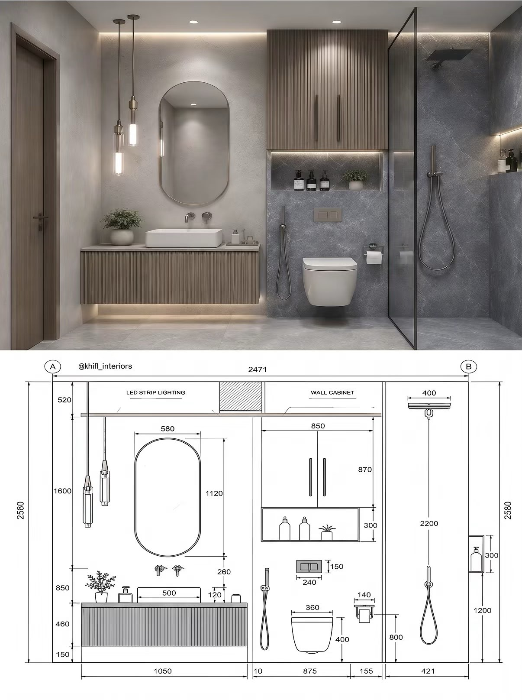

# مرجع تصميم: قطاع (Elevation) حائط حمام — رقم 01

- **المصدر:** @khifl_interiors (مرجع إلهام — مش رسم تنفيذي)
- **النوع:** واجهة/قطاع حائط واحد بيجمع 3 مناطق: الحوض ← التواليت (WC) ← الشاور
- **الوحدات:** مليمتر (mm)
- **الطراز:** مودرن / Japandi دافئ — خشب مضلع (Fluted) + رخام رمادي + إضاءة مخفية

---

## 1) الأبعاد العامة

| البند | القيمة |
|---|---|
| عرض الحائط (بين المحورين A و B) | **2471** |
| الارتفاع من الأرضية للسقف | **2580** |
| شريط سقف/سوفيت فيه LED Strip | **520** (حسب الرسم) |

## 2) تقسيم المناطق أفقياً (من الشمال لليمين)

| المنطقة | العرض |
|---|---|
| وحدة الحوض (Vanity) | **1050** |
| فاصل/سماكة حائط بين الحوض والـ WC | **10** |
| منطقة التواليت (حتى الحامل) | **875** |
| من حامل المناديل لحد الزجاج | **155** |
| منطقة الشاور (الجزء الظاهر في القطاع) | **421** |

> الحائط خلف الـ WC والشاور **بارز (Box-out)** عن حائط الحوض — ده اللي مخبي السيفون المدفون (Concealed Cistern) والمواسير.

## 3) منطقة الحوض (Vanity Zone)

| العنصر | البُعد |
|---|---|
| الوحدة معلقة — من الأرض لأسفل الوحدة | **150** (فيها LED Strip تحت الوحدة) |
| ارتفاع كابينة الحوض | **460** |
| ارتفاع سطح الرخامة من الأرض | **≈ 850** (الارتفاع القياسي) |
| عرض الحوض (Vessel Basin مستطيل فوق الرخامة) | **500** |
| ارتفاع جسم الحوض فوق الرخامة | **120** |
| المسافة من الحوض للخلاط الحائطي | خلاط حائطي (Spout + يد تحكم منفصلة) |
| المسافة من الخلاط لأسفل المراية | **260** |
| المراية (كبسولة / Pill shape بإطار معدني رفيع) | **580 عرض × 1120 ارتفاع** |
| إضاءة | 2 دلاية (Pendants) زجاج أسطواني بارتفاعين مختلفين، على شمال المراية |

## 4) منطقة التواليت (WC Zone)

| العنصر | البُعد |
|---|---|
| تواليت معلق (Wall-hung) — عرض | **360** |
| ارتفاع المقعد من الأرض | **400** |
| زرار السيفون المدفون (Flush Plate) | **240 × 150** — في منتصف محور الـ WC |
| شطاف (Bidet Spray) | على شمال التواليت، معلق على الحائط |
| حامل المناديل | عرض **140** — ارتفاع **800** من الأرض، على يمين الـ WC |
| نيش مفتوح فوق الـ WC | ارتفاع **300** + LED مخفي في سقف النيش |
| دولاب حائط علوي (Wall Cabinet) | **850 عرض × 870 ارتفاع** — ضلفتين خشب Fluted بمقابض طولية، لحد السقف |

## 5) منطقة الشاور (Shower Zone)

| العنصر | البُعد |
|---|---|
| رأس الدش (Rain Shower) مربع | **400 × 400** |
| ارتفاع رأس الدش من الأرض | **2200** |
| دش يدوي (Hand Shower) على حامل حائطي | مع خلاط مدفون |
| نيش الشاور | ارتفاع **300** — يبدأ على **1200** من الأرض + LED |
| الفاصل | زجاج ثابت (Walk-in) بإطار أسود رفيع، من الأرض للسقف |

---

## 6) الخامات والتشطيبات

- **حائط الحوض:** بياض/مايكروسمنت رمادي فاتح ناعم.
- **حائط الـ WC والشاور:** بورسلين Large-format شكل رخام رمادي غامق بعروق بيضا.
- **الأرضية:** بورسلين رمادي فاتح مطفي (Matt) بنفس روح الرخام.
- **النجارة:** قشرة خشب Fluted (مضلع رأسي) لون رمادي/بني دافئ — نفس الخامة للحوض والدولاب العلوي = وحدة في التصميم.
- **الرخامة:** سطح رفيع فاتح (Quartz/رخام بيج فاتح).
- **الأدوات الصحية والإكسسوارات:** لون **Gunmetal / Gun Grey** موحّد (خلاطات، شطاف، دش، حامل مناديل، إطار المراية).
- **الباب:** خشب غامق بمقبض أسود.

## 7) الإضاءة (طبقات)

1. **Cove / LED Strip** في السقف بطول الحائط (إضاءة عامة ناعمة).
2. **Spot lights** مدفونة في السقف.
3. **Pendants** دلايات جنب المراية (إضاءة مهمة Task + ديكور).
4. **LED تحت وحدة الحوض** (تأثير Floating).
5. **LED في النيش** فوق الـ WC وفي نيش الشاور (إبراز).

---

## 8) قواعد تصميمية نستفيدها من القطاع ده

- الوحدات المعلقة (حوض + WC) + LED تحتها = إحساس بالمساحة وسهولة تنضيف.
- الـ Box-out خلف الـ WC بيستغل في: السيفون المدفون + نيش + دولاب تخزين لحد السقف.
- توحيد خامة النجارة ولون الأدوات الصحية بيدي هوية واحدة للحمام.
- تباين خامتين للحيطان: فاتح (منطقة جافة) / غامق (منطقة مبلولة).
- المراية والدلايات والحوض على محور واحد تقريباً — راجع المحاور في التنفيذ.

## 9) مقارنة بالمعايير الشائعة

| العنصر | في القطاع | المعتاد |
|---|---|---|
| ارتفاع سطح الحوض | ≈ 850 | 800 – 900 ✅ |
| ارتفاع مقعد WC معلق | 400 | 400 – 430 ✅ |
| ارتفاع رأس الدش | 2200 | 2000 – 2200 ✅ |
| ارتفاع حامل المناديل | 800 | 600 – 750 ⚠️ أعلى شوية من المعتاد |
| ارتفاع نيش الشاور | 1200 – 1500 | 1000 – 1500 ✅ |
| أسفل المراية فوق الحوض | ~380 من الرخامة (120 + 260) | 200 – 400 ✅ |

## 10) ⚠️ ملاحظات على دقة الرسم (لازم تتراجع قبل أي تنفيذ)

الرسم **توضيحي ومش بمقياس رسم**، وفيه تعارض في سلاسل الأبعاد:

- **رأسياً:** 150 + 460 + 850 + 1600 + 520 = **3580** بينما الارتفاع الكلي **2580**. الأرجح إن الـ **850 هو ارتفاع الرخامة من الأرض** (مش مسافة إضافية)، أو إن الـ 1600 مكتوب غلط. يُعاد حسابها على الموقع.
- **أفقياً:** 1050 + 10 + 875 + 155 + 421 = **2511** + إزاحة الحوض عن المحور A، بينما الإجمالي **2471** → فرق ≥ 40 مم.
- رقم **10** بين الحوض والـ WC صغير جداً كسماكة حائط Box-out (الطبيعي 150–250 لسيفون مدفون) — غالباً المقصود فاصل/ضلفة بسيطة أو خطأ في الكتابة.
- منطقة الشاور **421** هي الجزء الظاهر فقط في القطاع؛ أقل عرض مريح لشاور Walk-in هو **800–900**.

**الخلاصة:** نستخدم القطاع ده كمرجع **للتوزيع والأفكار والخامات ونسب العناصر**، ونستخدم الأرقام كقيم استرشادية بعد التحقق من مقاسات الموقع الفعلية.
